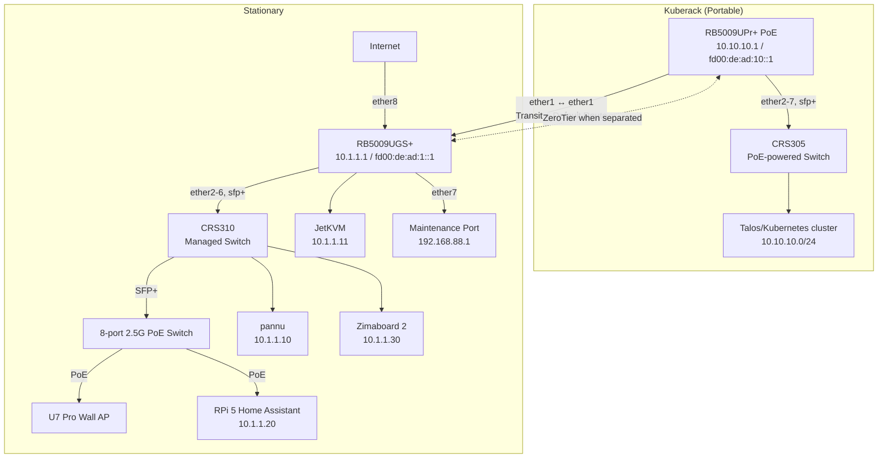

# Local Networking

This manages the MikroTik routers that provide redundant connectivity between the portable kuberack and stationary infrastructure.

## Network Setup

The network is composed of two main logical networks, connected by a 2.5Gbps interconnect when docked.

- **Kuberack LAN**: `10.10.10.0/24` / `fd00:de:ad:10::/64` (portable stack on the RB5009 + CRS305 switch)
- **Stationary LAN**: `10.1.1.0/24` / `fd00:de:ad:1::/64` (stationary stack; single gateway/DHCP on the stationary router at `10.1.1.1`)
- **Transit Link**: `10.254.254.0/30` / `fd00:de:ad:ff::/64` (point-to-point between routers)
- **ZeroTier VPN**: `10.255.255.0/24` (for site-to-site connectivity when separated)

### Network Diagram



## How It Works

_Note: The following describes the target architecture for the network. The implementation is ongoing and details are subject to change._

This network is designed for high performance when docked and graceful reachability when separated, without VRRP complexity.

### Docked (Normal Operation)

- **Stationary Gateway**: The RB5009UGS+ is the sole internet gateway for both LANs.
- **Transit Link**: Dedicated point-to-point link between kuberack (ether1) and stationary (ether1) using `10.254.254.0/30` (IPv4) and `fd00:de:ad:ff::/64` (IPv6).
- **Routing**: Stationary has a static route to `10.10.10.0/24` via `10.254.254.1`. Kuberack uses stationary as its default gateway - all internet traffic flows through the transit link to stationary.

### Separated Mode (Fallback Operation)

- **ZeroTier Paths**: High-distance routes over ZeroTier connect `10.10.10.0/24` and `10.1.1.0/24` when the wired interconnect is absent.
- **Kuberack Upstream**: When separated, kuberack needs its own WAN connection or ZeroTier path to reach the internet.

## Adopting a bootstrapped router

Bootstrap installs a self-signed HTTPS certificate. Until Terraform installs the
managed certificates, both the importer and RouterOS providers need the existing
`ALLOW_INSECURE` override. Restrict the override to this bootstrap procedure;
normal plans and applies must verify the managed certificate. Run from the
repository root:

```sh
terraform -chdir=local-networking init
(
  export TF_VAR_ALLOW_INSECURE=true
  just adopt-bootstrap --router stationary --router kuberack
  just adopt-bootstrap --router stationary --router kuberack --apply
  terraform -chdir=local-networking plan -out=bootstrap.tfplan
  # Review the plan before applying it.
  terraform -chdir=local-networking apply bootstrap.tfplan
)
terraform -chdir=local-networking plan
```

Select only the router being commissioned when resetting one site. The subshell
limits the override to this commissioning session; the final plan checks access
with normal certificate verification. Terraform saved plans include variable
values, so do not reuse this bootstrap plan for subsequent operations. The
importer never automatically retries with certificate verification disabled.

## Certificates

Each router serves a Let's Encrypt certificate issued with a new key on the
first apply of each month, and holds Let's Encrypt's intermediates and
cross-signed root, pinned by URL in `main.tf`. See
[ADR 3](../docs/adr/0003-router-certificates-with-a-pinned-chain.md) for why.
Test changes with `nix develop .#chr-bootstrap --command just chr run cert-renewal`
from `~/config/infra`.

- **New intermediate:** a renewal from an unpinned one fails its precondition.
  Add its URL to `data.http.letsencrypt_chain` and apply.
- **`chain_expiry` warning:** if Let's Encrypt re-issued the certificate, import
  its current file over the installed one, which RouterOS does in place:
  `scp <key>.pem admin@<router>:` then
  `ssh admin@<router> '/certificate import file-name=<key>.pem passphrase=""'`.
  Otherwise retire it.
- **Retiring an intermediate:** remove its URL only after both routers serve
  leaves from another.
- **Expired leaf:** plans fail verification. Apply once with
  `TF_VAR_ALLOW_INSECURE=true`.

## Provisioning Responsibilities

**Bootstrap script (one-time after reset)**

- Set system identity and build the LAN bridge (ports, MAC).
- Set management IPv4 addresses on the LAN bridge and transit interface, and add IPv4 routes to the peer LAN via transit.
- Configure transit interface with IPv6 address and add to LAN/MGMT_ALLOWED lists.
- Add symmetric IPv6 management routes for use when IPv6 is enabled:
  - Stationary: route to `fd00:de:ad:10::/64` via `fd00:de:ad:ff::1` (kuberack transit)
  - Kuberack: route to `fd00:de:ad:1::/64` via `fd00:de:ad:ff::2` (stationary transit)
- Add static DNS A and AAAA records for both routers (resolving to local bridge IPs); disable AAAA records for routers with IPv6 disabled.
- Create interface lists (WAN/LAN/MGMT_ALLOWED), baseline firewall/NAT, WAN DHCP client, enable DNS, generate self-signed certs, optionally install ZeroTier binary.
- DHCP servers and leases are configured by Terraform afterward.

Run the bootstrap importer before the first apply after commissioning or reset.
It binds the existing management IPv4 addresses, peer IPv4 routes, router DNS
records, static firewall rules/address lists, global IPv6 settings, and LAN
advertisements to the per-router bootstrap modules in Terraform state. Terraform then manages these objects on subsequent applies.

Firewall definitions in `modules/bootstrap/firewall.tf` also render the bootstrap
script. Terraform manages IPv4/IPv6 filter ordering; dynamic rules stay unmanaged.

`enable_ipv6=false` disables all IPv6, including local routing, advertisements,
and router AAAA records. Enable it only with working upstream IPv6: local-only
IPv6 would need explicit client routes instead of the advertised default route.

For existing routers: adopt first, review/apply Terraform, then **reboot each
router** (`/system reboot`) and verify IPv4 access. Terraform does not reboot them.
Reconnect clients that retain old IPv6 routes or DNS settings.

**Terraform apply (ongoing)**

- Manage adopted IPv4 addressing: `10.1.1.1/24` on stationary bridge; `10.254.254.2/30` on stationary transit (ether1); `10.254.254.1/30` on kuberack transit (ether1); `10.10.10.1/24` on kuberack bridge.
- DHCP: `stationary-dhcp` for 10.1.1.0/24 with static leases; `kuberack-dhcp` for 10.10.10.0/24 with static leases.
- IPv6: manage the adopted settings and advertisements; request WAN prefix delegation only when enabled.
- DNS: resolver settings plus static records/adlists on both routers.
- Routing: manage adopted peer routes via transit; add ZeroTier fallback routes (distance 200) both ways.
- ZeroTier instances/interfaces/addresses and MGMT_ALLOWED membership.
- Users/certs/QoS: mktxp & external_dns users, ACME certs, cake QoS on kuberack WAN, and uploading the bootstrap script.

## VPN

When sites are separated, Zerotier maintains connectivity between the `10.10.10.0/24` and `10.1.1.0/24` networks:

- **VPN Network**: `10.255.255.0/24`
- **RB5009 VPN IP**: `10.255.255.1`
- **RB5009UGS VPN IP**: `10.255.255.2`
- **Purpose**: Site-to-site connectivity, service access, management

## Implementation

The configuration is organized into two Terraform modules:

- **`module.stationary`**: Stationary infrastructure
- **`module.kuberack`**: Kuberack infrastructure

### Usage

- **Normal operation**: `terraform apply`
- **Stationary only**: `terraform apply -target=module.stationary -target=module.bootstrap_stationary`
- **Kuberack only**: `terraform apply -target=module.kuberack -target=module.bootstrap_kuberack`

### SSH Access

SSH keys are managed via Terraform from the `ssh_public_keys` field in the secret.

```bash
ssh kuberack    # kuberack router
ssh stationary  # stationary router

# run commands directly
ssh kuberack /interface/list/member/print
ssh stationary /ip/route/print
```

### Bootstrap Scripts

Minimal RouterOS bootstrap scripts handle the initial setup required to prepare a device for Terraform management. The script files (`stationary.rsc` and `kuberack.rsc`) are generated by Terraform from a single template (`bootstrap.tftpl.rsc`) and are checked into version control.

The final, complex configuration (like VRRP and high-performance routing) is managed by Terraform, which also uploads the latest version of the bootstrap script to the device on every `apply`.

If you modify the template or the configuration variables in `main.tf`, running `terraform apply` will automatically update the script files in `bootstrap/generated/`. You should then review these changes and commit them to version control.

## Bootstrap Process

To bootstrap a new MikroTik device or to update an existing one with the latest script, follow these steps:

1.  **Update Scripts (If Needed)**: If you have changed the bootstrap template or variables, run `terraform apply`. This will update the script files in `bootstrap/generated/`. Review the changes with `git diff` and commit them. For a first-time setup, the necessary scripts are already in the repository.

2.  **Upload Bootstrap Script**: Access the device's UI (WinBox or HTTP) and upload the device-specific bootstrap script (e.g., `stationary.rsc` or `kuberack.rsc`) from the `bootstrap/generated/` directory.

3.  **Reset Configuration**: Navigate to `System -> Reset Configuration` in the UI. Select `No Default Configuration` and choose the script uploaded in Step 2 from the `Run after Reset` option. Confirm and reset the device.

4.  **Initial Access & Configuration**: After the device reboots, it will be accessible by connecting your computer to any of the LAN ports. Your computer will receive an IP address via DHCP in the appropriate range. Access the router at its management IP (`10.1.1.3` for the RB5009UGS).

5.  **Set Admin Password**: Log in with the username `admin` and no password. Immediately set a strong password for the `admin` user. This password should match the credentials defined in your secrets (viewable via `just view`).

6.  **Terraform Management**: The device is now ready for Terraform. Run `terraform apply` again. Terraform will connect via the device's IP and apply the final configuration. It will also upload the latest version of the bootstrap script, so for future updates, you only need to re-run the reset step (Step 3).

## TODO

- [ ] Implement stationary module (RB5009UGS)
  - [x] Minimal bootstrap script
  - [x] Basic network configuration (IP addressing, DHCP)
  - [x] Configure DHCP server with static leases (pannu, JetKVM)
  - [x] Firewall rules
- [ ] Implement kuberack module (RB5009 + CRS305)
  - [x] RB5009 minimal bootstrap script
  - [x] RB5009 basic network configuration
  - [ ] CRS305 minimal bootstrap script (basic Layer 2 switch)
  - [x] RB5009 firewall rules
  - [ ] CRS305 basic switch configuration
- [x] DNS and Peer Configuration
  - [x] Set system identity for each router
  - [x] Add authoritative DNS records for all devices (pannu, JetKVM)
- [x] VPN configuration
  - [x] ZeroTier site-to-site tunnel configuration
  - [x] Routing between sites when separated (fallback routes with proper metrics)
  - [x] Management access via ZeroTier tunnel
- [x] Testing and validation
  - [x] Test failover scenarios (~16-17 second convergence time)
  - [x] Performance testing (~50Mbps through ZeroTier tunnel)
- [ ] Refactoring
  - [ ] move DHCP servers to terraform, with initial config being done with static IP configuration
- [ ] CRS310 VLAN-based transit link (future enhancement)
  - [ ] Add CRS310 to Terraform management
  - [ ] Configure VLAN 100 for transit traffic between kuberack and stationary
  - [ ] Set kuberack-facing port as access VLAN 100
  - [ ] Set stationary-facing SFP+ as trunk (VLAN 1 + VLAN 100)
  - [ ] Move transit IP to VLAN interface on stationary (frees ether2 for bridge)
  - [ ] Benefits: No dedicated transit port needed, all router ports available for LAN

## Important Notes

### Device Mode Restrictions

Some MikroTik devices have device-mode security features that may block certain packages like ZeroTier by default. If ZeroTier fails to start, you may need to:

1. **Check if ZeroTier is enabled**:

   ```
   /system device-mode print
   ```

2. **Enable ZeroTier in device mode** (if not already enabled):

   ```
   /system device-mode update zerotier=yes
   ```

3. **Physically press the MODE button** on the device to confirm the change (if applicable)

4. **Reboot the device** for the change to take effect

Without this step, ZeroTier instances may fail to start with device-mode related errors.
